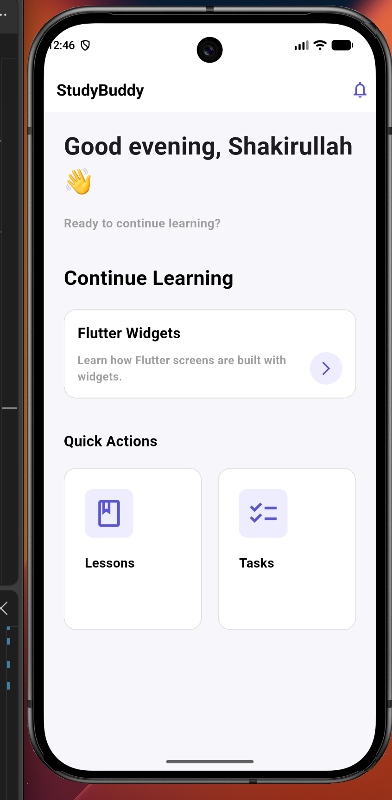

# StudyBuddy

StudyBuddy is a simple Flutter mobile UI project created during the GDG LASU Beginner Mobile Development Bootcamp.

The project is designed as a practical example for learning how basic Flutter widgets can be combined to build a mobile app screen.

## Current Screen

## Screenshot



The current screen includes:

- A simple AppBar with the StudyBuddy title and notification icon
- A personalized greeting section
- A "Continue Learning" section
- Quick action cards for Lessons and Tasks
- Basic spacing, padding, colors, and text styling

The current version focuses on the user interface only. The buttons and sections are not connected to any real functionality yet.

## What This Project Demonstrates

This project uses basic Flutter widgets such as:

- `MaterialApp`
- `Scaffold`
- `AppBar`
- `Text`
- `Icon`
- `Container`
- `Padding`
- `SizedBox`
- `Row`
- `Column`

It is intended to help beginners understand how Flutter widgets are structured and combined to create a mobile screen.

## Tech Stack

- Flutter
- Dart
- Material Design

## Getting Started

### 1. Clone the repository

```bash
git clone https://github.com/Shakirullah-builds/study-buddy-flutter.git